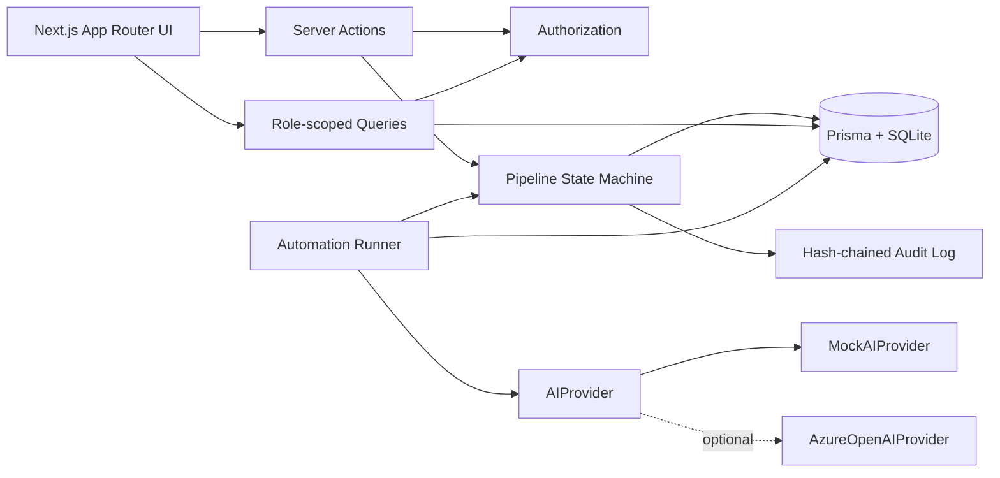
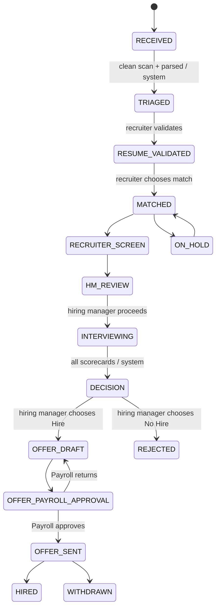

# TalentFlow

TalentFlow is a local, demo-ready recruiting operations portal. It standardizes intake, matching, interviews, decisions, offers, compensation approval, SLAs, security checks, and audit evidence while preserving human control at every consequential decision.

## Run locally

Requirements: Node.js 20+ and npm. No Docker, cloud account, or API key is required.

```bash
npm install
npx prisma migrate dev
npm run seed
npm run dev
```

Open <http://localhost:3000>. Use the header switcher to move between the seeded users and seven roles.

Validation:

```bash
npm test
npm run lint
npm run build
```

## Five-minute demo

1. Start as **Sofía Álvarez (Coordinator)**. Open **Intake queue**, simulate three inbox CVs, review scan and parsing results, select records, and bulk-assign them.
2. Switch to **Valentina Ruiz (Recruiter)**. Open a triaged candidate, review the plain-text resume and security flags, validate the profile, select one of the three scored requisition matches, and advance through the recruiter screen.
3. Switch to **Carolina Méndez (Hiring Manager)**. Open **HM cockpit** to see her dense 20-requisition portfolio, choose a candidate in HM review, and proceed to interviews.
4. Switch to **Mateo Silva (Interviewer)**. Open **Interviews**, submit a 1–4 structured scorecard with competency evidence, and note that another interviewer's notes remain restricted until submission.
5. Run automation from **Operations** as **Diego Campos (Admin)**. Complete scorecards auto-advance the application to Decision. Return to Carolina, record Hire, and draft an offer as Valentina.
6. Switch to **Lucía Herrera (Payroll)**. Compare base pay with the template band, enter the mandatory review comment, and approve the package. Switch back to Valentina to record acceptance and Hired.
7. Finish on **Leader dashboard** for SLA, aging, workload, source, stage-time, and funnel views; then **Operations** for quarantine, AI quality, audit integrity, automation, and the editable cost model.

## Architecture





Important modules:

- `lib/pipeline.ts`: legal transitions, role ownership, prerequisites, and structured errors.
- `lib/authz.ts`: role-scoped query filters and field visibility rules.
- `lib/automation/*`: inbox, scan/parse, routing, SLA, scorecard, auto-advance, evaluation, and retention jobs.
- `lib/ai.ts`: deterministic mock and optional Azure OpenAI implementations.
- `lib/audit.ts`: append-only SHA-256 hash chain and integrity verification.
- `prisma/schema.prisma`: complete local domain model.

## What is mocked vs. real

| Capability | Prototype behavior |
|---|---|
| Authentication | Mocked with a named-user role switcher; authorization and query scoping are enforced server-side |
| Inbox and uploads | Simulated from 20 labeled JSON fixtures |
| Malware scan | Real deterministic MIME, size, macro extension, SHA-256, and deny-list checks; no external malware engine |
| Resume parsing and matching | Real deterministic rules through `MockAIProvider`; optional Azure OpenAI provider is implemented |
| Workflow | Real persisted state machine through Server Actions |
| SQLite persistence | Real Prisma database, migrations, relations, and seeded history |
| Audit integrity | Real append-only records with a SHA-256 hash chain and verification |
| Email and calendar | Generated state only; nothing is sent |
| Cost model | Live calculations from editable, clearly labeled assumptions |

## Security and compliance demonstration

- Payroll queries compensation context without interview notes; interviewers cannot query compensation; hiring managers are scoped to their requisitions.
- Resume text is rendered as escaped plain text. Prompt-injection language is a blocking red flag and is excluded from matching.
- PDF/DOCX, 10 MB, macro, deny-list, and SHA-256 checks are applied before parsing.
- Consent and retention dates are visible. The retention job anonymizes rather than deletes and adds an audit row.
- Rejections, overrides, scorecards, offer exceptions, and Payroll responses require evidence.
- Audit rows cannot be updated through the application and can be verified from Operations.

## AI configuration

The deterministic mock is the default. Azure OpenAI is selected only when all variables are set:

```env
AZURE_OPENAI_ENDPOINT=""
AZURE_OPENAI_KEY=""
AZURE_OPENAI_DEPLOYMENT=""
```

Copy `.env.example` to the deployment environment and use secret injection; never commit keys.

## Cost assumptions

Operations starts with 1,000 CVs/month, 5,500 tokens for parse plus match, $0.002/1K tokens, $185/month hosting, $25/month storage, 20 seats at $8/seat, and a manual baseline of 45 recruiter minutes per CV at $38/hour. Every input is editable and the UI recalculates monthly, per-candidate, and modeled savings immediately.

## Path to production on Azure

1. Host Next.js on **Azure App Service** or **Azure Container Apps** with managed identity.
2. Replace SQLite with **Azure SQL** and run reviewed Prisma migrations in the release pipeline.
3. Store resumes in private **Azure Blob Storage** using short-lived access and **Defender for Storage** malware scanning.
4. Configure `AzureOpenAIProvider` with **Azure OpenAI**, private networking, managed identity where supported, content filters, grounded prompts, evaluation gates, and full latency/cost telemetry.
5. Replace the role switcher with **Microsoft Entra ID**, app roles, group assignment, conditional access, and least-privilege API authorization.
6. Implement mailbox intake with **Microsoft Graph** or **Logic Apps**, idempotency, dead-letter handling, and consent capture.
7. Add Azure Monitor/Application Insights, Key Vault, restore-tested backups, regional availability requirements, retention policies, legal holds, and an audited break-glass process.

## Before a customer pilot

The three highest-priority hardening items are real Entra authentication and tenant-scoped authorization tests; isolated encrypted resume storage with Defender scanning and formal retention/legal-hold controls; and production-grade audit durability, concurrency-safe ledger sequencing, monitoring, backup, and incident response.
